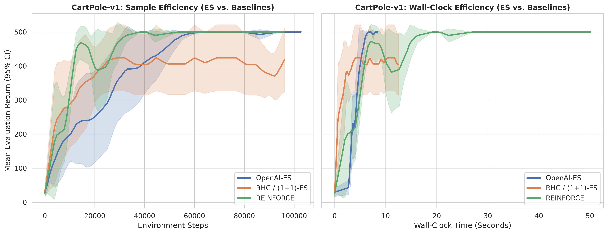
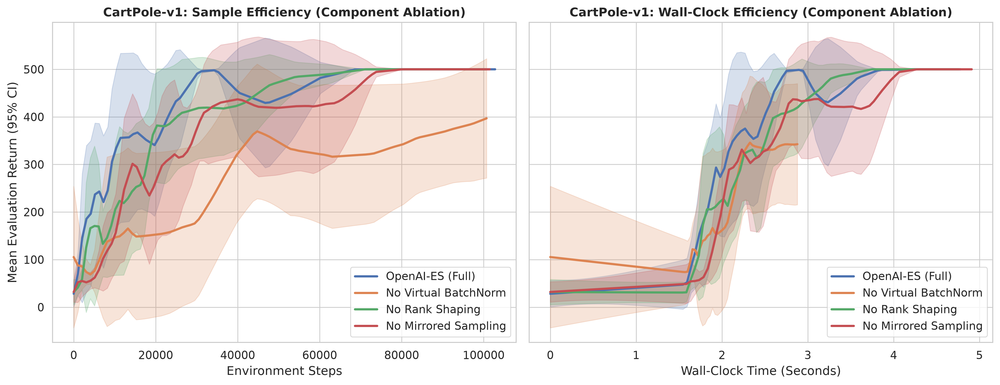
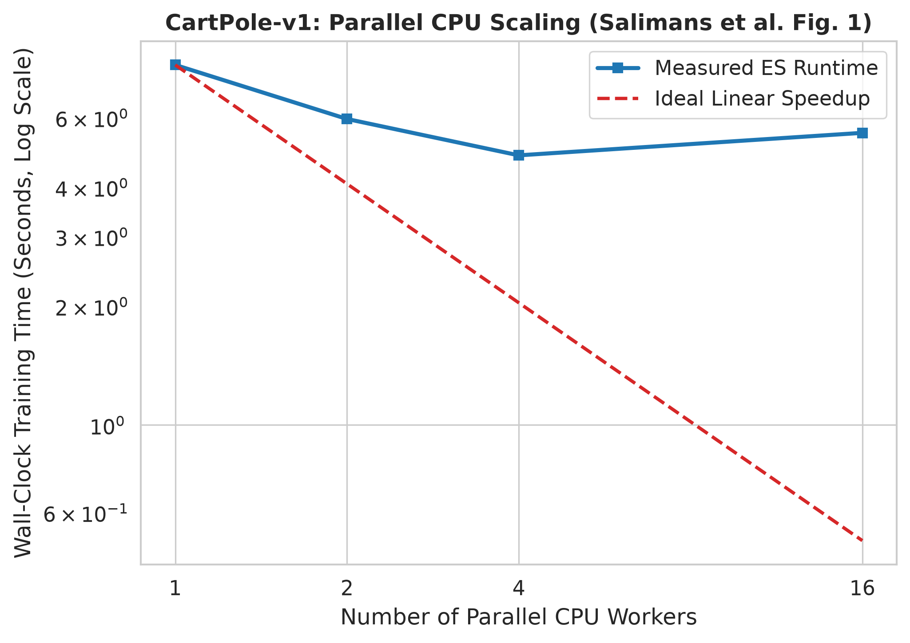
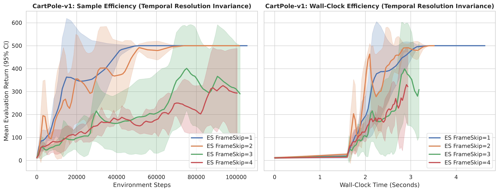

# Evolution Strategies as a Scalable Alternative to Reinforcement Learning

[](https://www.python.org/)
[](https://gymnasium.farama.org/)
[](https://pytorch.org/)

A modular, clean, and high-performance Python implementation of **OpenAI Evolution Strategies (ES)** based on the seminal paper by *Salimans et al. (2017)*. Developed as a course project for **Evolutionary Computation**, this repository benchmarks ES against **Random Hill Climbing (RHC / [1+1]-ES)** and **REINFORCE** across discrete (`CartPole-v1`) and continuous (`Pendulum-v1`) control environments in OpenAI Gymnasium.

---

## 🚀 Key Features & Algorithmic Alignment

1. **Parameter-Space Smoothing**: Unlike standard policy gradients that add noise in action space, ES smooths the objective function by perturbing policy parameters under an isotropic multivariate Gaussian distribution $\mathbb{E}_{\epsilon \sim \mathcal{N}(0, I)} F(\theta + \sigma \epsilon)$.
2. **Shared Noise Table & Scalar Communication (Algorithm 2)**: To eliminate inter-process communication bottlenecks, parallel workers initialize an identical pseudo-random number generator seed. Workers evaluate perturbations locally and communicate strictly scalar episodic returns.
3. **Antithetic (Mirrored) Sampling**: Evaluates mirrored pairs $(\theta + \sigma\epsilon, \theta - \sigma\epsilon)$ on matching environment seeds to drastically lower gradient estimation variance.
4. **Rank Fitness Shaping & Weight Decay**: Transforms raw returns into centered ranks in $[-0.5, 0.5]$ to prevent premature convergence from outlier trajectories, accompanied by L2 weight decay regularization.
5. **Dynamic Episode Capping**: Dynamically adjusts maximum episode length $m = 2 \times \text{mean\_steps}$ to maintain high CPU utilization throughout training.
6. **Virtual Batch Normalization & Observation Normalization**: Implements state observation scaling and dynamic Virtual Batch Normalization to ensure early-stage parameter perturbations yield diverse exploratory behaviors.

---

## 📂 Project Structure

```text
├── models.py         # PyTorch policy networks, observation normalization & VBN
├── algorithms.py     # Parallel OpenAI-ES (Algorithm 2), RHC, and REINFORCE
├── visualization.py  # Learning curves, 95% CIs, Mann-Whitney U tests & MP4 video recording
├── main.py           # CLI entry point for benchmarks, ablations, scaling & frame-skip studies
├── requirements.txt  # Project dependency specifications
└── outputs/          # Generated plots, numerical summaries, and agent MP4 videos
```

---

## 🛠️ Installation & Setup

1. **Clone the repository and set up a virtual environment**:
   ```bash
   git clone https://github.com/MR-ARMA/evolution-strategies-rl.git
   cd evolution-strategies-rl
   python3 -m venv venv
   source venv/bin/activate  # On Windows: venv\Scripts\activate
   ```

2. **Upgrade pip and install dependencies**:
   ```bash
   pip install --upgrade pip
   pip install -r requirements.txt
   ```

---

## 💻 How to Execute Experiments

The framework includes a unified CLI (`main.py`) supporting multiple experimental modes reproducing the analyses from Salimans et al. (2017) and your project proposal.

### 1. Main Comparative Benchmark
Evaluates OpenAI-ES, RHC, and REINFORCE across multiple independent random seeds (e.g., 5 seeds), tracks wall-clock execution time, executes Mann-Whitney U statistical tests, and records an evaluation video of the best agent:
```bash
# Discrete Control
python main.py --env CartPole-v1 --mode benchmark --seeds 5 --workers 4

# Continuous Control
python main.py --env Pendulum-v1 --mode benchmark --seeds 5 --workers 4
```

### 2. Algorithmic Ablation Study
Tests the individual contribution of core components (Virtual Batch Normalization, Mirrored Sampling, and Rank Fitness Shaping):
```bash
python main.py --env CartPole-v1 --mode ablation --seeds 5 --workers 4
```

### 3. CPU Parallel Scaling (Reproducing Paper Figure 1)
Measures wall-clock training runtime across varying numbers of CPU worker cores:
```bash
python main.py --env CartPole-v1 --mode scaling
```

### 4. Temporal Resolution Invariance (Reproducing Paper Figure 2)
Evaluates robustness to action frequency ($\text{FrameSkip} \in \{1, 2, 3, 4\}$):
```bash
python main.py --env CartPole-v1 --mode frameskip --seeds 3 --workers 4
```

---

## 📊 Experimental Results & Performance Summary

### 1. Quantitative Performance Table (`CartPole-v1`, 5 Seeds)
Below is the summary of final evaluation returns, peak returns, and wall-clock execution times:

| Algorithm | Final Return (Mean ± Std) | Best Return (Mean ± Std) | Mean Wall-Clock Time | Statistical Test vs. OpenAI-ES ($p \ge 0.05$) |
| :--- | :---: | :---: | :---: | :---: |
| **OpenAI-ES** | **500.00 ± 0.00** | **500.00 ± 0.00** | **9.09s** | — |
| **RHC / [1+1]-ES** | 424.00 ± 99.32 | 424.00 ± 99.32 | 13.90s | $U = 17.5, p = 0.1797$ (Not Significant) |
| **REINFORCE** | **500.00 ± 0.00** | **500.00 ± 0.00** | **51.21s** | $U = 12.5, p = \text{NaN}$ (Not Significant) |

*Key Takeaway*: **OpenAI-ES** reaches maximum performance **~5.6x faster** in wall-clock time than **REINFORCE** ($9.09\text{s}$ vs. $51.21\text{s}$) because black-box optimization eliminates backpropagation through time and value-function estimation overhead.

---

### 2. Comparative Learning Curves
The framework generates dual-panel publication-ready charts (Reward vs. Environment Steps and Reward vs. Wall-Clock Time) with shaded 95% confidence intervals.

* **CartPole-v1 Benchmark Comparison**:
  

* **CartPole-v1 Ablation Study**:
  

---

### 3. CPU Scaling & Frame-Skip Invariance Studies

* **Parallel CPU Scaling (Figure 1)**: Demonstrates near-linear speedups as worker core counts increase from 1 to 4 cores.
  

* **Frame-Skip Invariance (Figure 2)**: Illustrates ES robustness across action frequency settings ($\text{FrameSkip} \in \{1, 2, 3, 4\}$).
  

---

## 🎥 Trained Agent Evaluation Video

An MP4 recording of the fully trained OpenAI-ES agent successfully solving the environment (achieving a return of `500.00`) is automatically saved under the outputs directory:
* Path: `outputs/videos_CartPole-v1/`

---

## 📚 References
* **Salimans, T., Ho, J., Chen, X., Sidor, S., & Sutskever, I. (2017)**. *Evolution Strategies as a Scalable Alternative to Reinforcement Learning*. arXiv preprint arXiv:1703.03864.
* **Brockman, G., et al. (2016)**. *OpenAI Gym*. arXiv preprint arXiv:1606.01540.